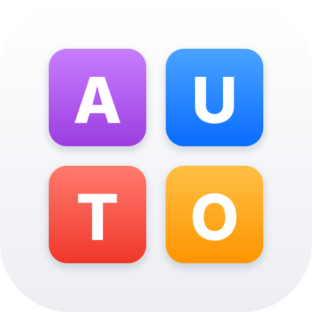
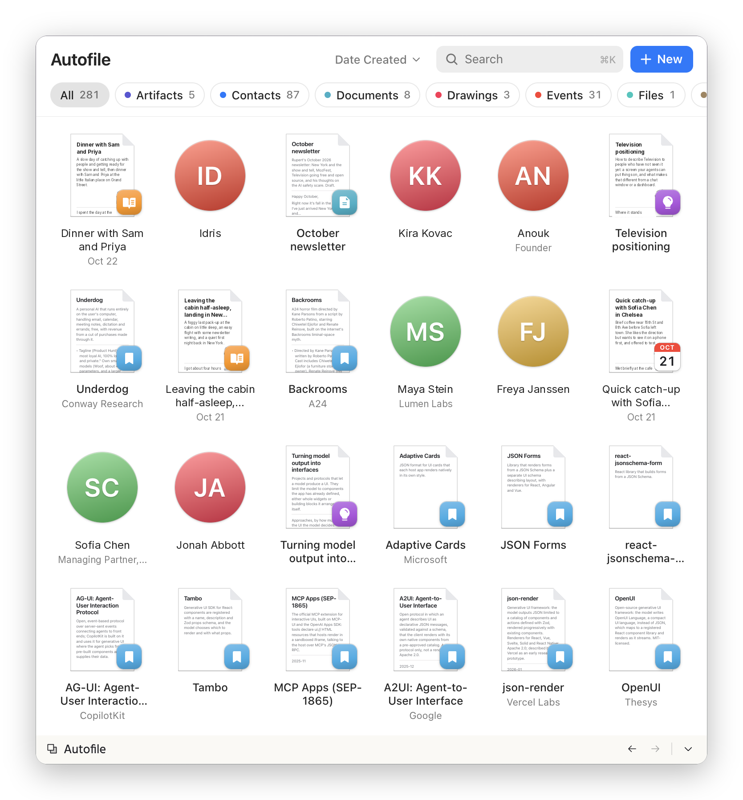

<p align="center">
  
</p>

<h1 align="center">Autofile</h1>

<p align="center">
  <strong>A portable, open filesystem for agents.</strong>
</p>

<p align="center">
  <a href="https://www.npmjs.com/package/@telepath-computer/autofile"></a>
  <a href="LICENSE"></a>
  
</p>

<p align="center">
  
  <br>
  <em>GUI coming soon</em>
</p>

**Agents file everything, and it never turns into a mess.** Every kind of information has one place and one shape, and anything that doesn't fit is turned away. A year of filing by any number of agents stays as coherent as the first day, and anything in it can still be found straight away.

**The live data layer for the apps you vibe-code.** Point an app at Autofile and it has storage, search, links, file attachments and live updates, with nothing else to build. The screens agents put up on [Television](https://github.com/telepath-computer/television) work this way: they change the moment an agent files something.

**Yours, wherever you take it.** Your records are plain files on your own machine, readable without Autofile and easy to move, back up or sync. Autofile is open source, and any agent that speaks [MCP](https://modelcontextprotocol.io) can use it.

## Get started

You need Node.js 24 or later.

1. Install Autofile:

   ```sh
   npm install -g @telepath-computer/autofile
   ```

2. Add it to your agent. For Claude Code:

   ```sh
   claude mcp add autofile --scope user -- autofile
   ```

   For another MCP client, add a server whose command is `autofile`, with no arguments.

3. Ask your agent to remember something.

Autofile starts empty. Your agent proposes types as it needs them, and creates each one once you agree.

## Serve over HTTP

For apps and agents that connect over HTTP, run:

```sh
autofile serve
```

This serves the same tools and resources at `http://127.0.0.1:7319/mcp`, and attachments next to it. Autofile does not authenticate HTTP clients, so anything that can reach the address can read and change every record. It listens only on this machine by default. [Serving over HTTP](spec/index.md#serving-over-http) explains how to change the address and which web pages it accepts.

## Use it as a library

Programs can use the same store directly:

```sh
npm install @telepath-computer/autofile
```

```js
import { Autofile } from "@telepath-computer/autofile";

const store = new Autofile({ folder: "./records" });
try {
  const { records } = await store.records.find({ q: "Ada Park" });
  for (const record of records) console.log(record.title ?? record.uri);
} finally {
  await store.close();
}
```

The [Library API](spec/index.md#library-api) covers writing records, declaring types, attachments and watching for changes.

## Status

Autofile is new and changing quickly. Until version 1.0, addresses, tools and the library API may change between minor versions.

## Specification

[spec/index.md](spec/index.md) describes records, types, links, attachments, the MCP tools and resources, and the commands. [Storage](spec/storage.md) specifies the folder format, and [Implementation](spec/implementation.md) describes the code.

## Development

```sh
npm install
npm test
```

`npm test` builds Autofile and runs the tests.

## Licence

[MIT](LICENSE)
